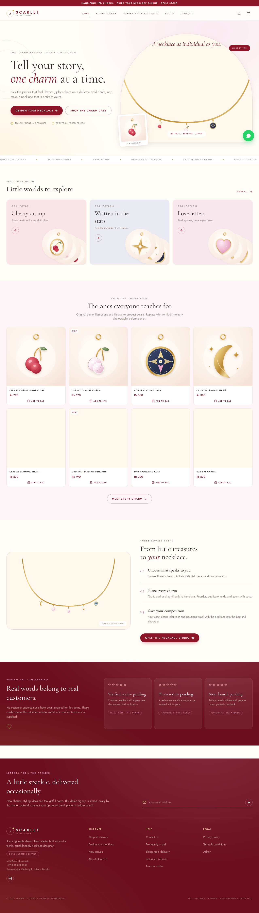
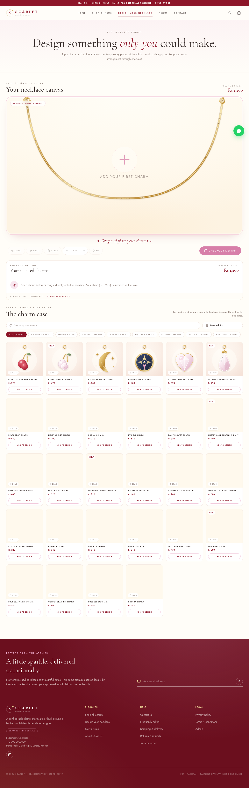
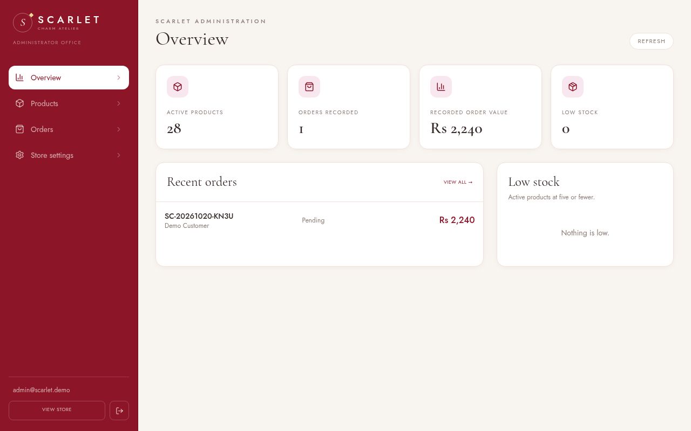

# SCARLET — Custom Jewellery Store

A complete responsive jewellery e-commerce demonstration built around a real interactive charm-necklace configurator.

> **Reference note:** no reference video file was available in the workspace during implementation. The interface follows the supplied written visual specification (ivory, blush, burgundy and gold; large cream necklace canvas; compact charm catalogue; mobile bottom navigation). **SCARLET** is therefore a configurable placeholder identity, not a claim about an existing company.



## What is implemented

### Customer storefront

- Editorial responsive home page, featured collections, popular charms and clearly-labelled review placeholders.
- 28 original vector demo charm illustrations (card and transparent necklace variants).
- Search, category filters, price/name/newest sorting and progressive catalogue loading.
- Product details, demo stock, quantity controls, related pieces and image fallbacks.
- Persistent browser cart and persistent in-progress necklace design.
- Full cart, configurable shipping estimates and server-authoritative checkout.
- Validated offline checkout (cash-on-delivery or bank-transfer-pending only).
- Database-backed orders with idempotency protection, immutable price/configuration snapshots and stock updates.
- Order confirmation and privacy-protected order tracking (order number + matching email/phone).
- Contact and newsletter forms stored by the demo backend.
- About, FAQ, shipping, returns, privacy and terms pages. Unverified policies are explicitly labelled draft content.
- Configurable WhatsApp control that does **not** invent a phone number when none is supplied.

### Necklace editor

- Scalable SVG gold necklace with metallic layered strokes.
- Pointer Events support for mouse, touch and stylus.
- Tap-to-add and true catalogue-to-canvas drag/drop.
- Snap-to-chain placement using nearest-point sampling on a two-part quadratic necklace curve.
- Existing-charm repositioning without duplication.
- Multiple instances of the same charm, unique instance IDs and normalised positions.
- Selected states, per-product quantities, individual/all removal and visual stacking.
- Multi-level Undo and Redo; new actions after Undo clear obsolete Redo history.
- Confirmation-based Clear that does not affect other bag items.
- 75%–175% Zoom and reset-to-fit; positions remain independent of zoom.
- Live unique-design count, total-piece count and PKR pricing.
- Keyboard support: focus a charm, move with Left/Right arrows and remove with Delete/Backspace.
- Exact product IDs and `t` positions persist into cart and the final order snapshot.



### Administration

- JWT authentication with bcrypt password hashes and server-side role checks.
- Dashboard statistics, recent orders and low-stock list.
- Add/edit/deactivate products, prices, demo stock, feature/new flags and categories.
- PNG/JPEG/WebP image upload with type and 3 MB size controls. SVG upload is intentionally rejected to avoid active-content risk.
- Order/customer review and fulfilment/payment status updates.
- Configurable chain price, shipping, free-shipping threshold, tax, announcement, contact data and WhatsApp number.
- Administrative API remains inaccessible without a valid signed token.



## Technology

- **Frontend:** React 18, TypeScript, Vite, Tailwind CSS, custom CSS, Lucide React.
- **State:** Zustand with versioned localStorage persistence for cart and design.
- **Editor:** SVG + native Pointer Events (no desktop-only HTML drag API).
- **Backend:** Express, Zod validation, JWT, bcrypt, Multer.
- **Database:** persistent SQLite via `better-sqlite3`, WAL mode, foreign keys and transactional order creation.
- **Assets:** local self-hosted fonts and original SVG demo illustrations; no external runtime CDN dependency.

The brief preferred Supabase. No Supabase project or credentials were supplied, so this build uses the permitted equivalent persistent backend. `server/schema.sql` contains the complete relational schema. For a multi-instance production deployment, migrate the same model to PostgreSQL/Supabase and replace the repository layer while keeping the typed HTTP contract.

## Quick start

Requirements: Node.js 20+ and npm.

```bash
cd scarlet
npm install
cp .env.example .env   # edit values before production
npm run dev
```

Development URLs:

- Storefront: `http://localhost:5173`
- API: `http://localhost:8787/api`
- Admin: `http://localhost:5173/admin`

The database is created and seeded automatically on first API start.

### Development-only administrator

When no admin environment variables are set, a local development database is seeded with:

```text
Email:    admin@scarlet.demo
Password: ScarletDemo2026!
```

These credentials are exposed in the development login helper deliberately and are **not suitable for deployment**. Set `ADMIN_EMAIL`, `ADMIN_PASSWORD` and a strong random `JWT_SECRET` before the first production seed. If a database has already been seeded, change its stored admin hash rather than expecting environment changes to rewrite that user.

## Environment

See `.env.example`.

| Variable | Purpose |
|---|---|
| `PORT` | Express port, default `8787` |
| `DATABASE_PATH` | Persistent SQLite file path |
| `JWT_SECRET` | Signing key; production startup refuses the built-in development key |
| `ADMIN_EMAIL` | Initial administrator email on an empty database |
| `ADMIN_PASSWORD` | Initial administrator password on an empty database |
| `VITE_WHATSAPP_NUMBER` | Optional fallback number, international digits only |

Public store values can also be changed in **Admin → Store settings**. No WhatsApp or contact number is invented by default.

## Commands

```bash
npm run dev        # Vite + API in development
npm run build      # strict TypeScript check + production bundle
npm run test:api   # isolated 19-check API/order/auth smoke suite
npm run check      # build and API smoke suite
npm run seed       # initialise/show seed counts
npm start          # serve built frontend and API from Express
```

## Database model

`server/schema.sql` creates:

- `categories`, `products`, `users`
- `carts`, `cart_items`
- `custom_necklace_designs`, `necklace_design_charms`
- `orders`, `order_items`, `payments`, `shipping_details`
- `settings`, `newsletter_subscribers`, `contact_messages`

Orders preserve names, unit prices, quantities and full custom-necklace JSON at purchase time. Later catalogue changes do not rewrite history. Order creation is a single transaction that validates active products and stock, reads prices/settings from the database, records all snapshots, and decrements stock.

Money is stored as whole PKR integers. The current calculation is:

```text
subtotal = direct products + configured chain base + every charm instance
shipping = configured method / configured standard free-shipping threshold
tax      = round((subtotal + shipping) × configured tax rate)
total    = subtotal + shipping + tax
```

The browser estimate is informative; the server result is authoritative.

## Payments

**No live payment provider is connected.** Checkout supports only:

- Cash on delivery → order payment status `unpaid`.
- Bank transfer → order payment status `pending`; no account details are fabricated.

The confirmation page says that no online payment was processed. To add online payments, implement a Pakistan-supported merchant provider, server-created payment sessions, signed webhook verification, reconciliation and refunds. Never collect raw card details in this application.

## Production deployment

For Vercel specifically, follow [`VERCEL_DEPLOY.md`](VERCEL_DEPLOY.md). The repository includes `vercel.json` and `api/index.mjs` for Vite SPA routing and an Express Vercel Function. Note that Vercel's `/tmp` SQLite storage is ephemeral; use Supabase/PostgreSQL or an external persistent API before taking live orders.

For a persistent Node/Docker deployment:

1. Set all server environment values and `NODE_ENV=production`.
2. Build with `npm ci && npm run build`.
3. Run `npm start` behind HTTPS. Express serves both the SPA and `/api`, avoiding cross-origin browser credentials.
4. Mount persistent storage for the configured SQLite file and `server/data/uploads`.
5. Back up the database and uploads, test restore procedures and rotate JWT/admin secrets.
6. Replace all demo product specifications, images, contact details and policy drafts with owner-verified content.
7. Replace placeholder `https://example.com` origins in `public/robots.txt` and `public/sitemap.xml`.
8. Configure a real email/support provider, observability and a platform/shared rate limiter if horizontally scaling.
9. For more than one application instance, move persistence to PostgreSQL/Supabase and shared object storage.
10. Perform physical iOS/Android touch UAT and merchant/legal review before accepting real orders.

## Security decisions

- Zod validates public and administrator payloads server-side.
- Prices, shipping, tax and stock are never trusted from the client.
- Idempotency keys prevent duplicate checkout submission.
- Passwords are bcrypt-hashed; JWTs expire after eight hours.
- Admin role checks run on every protected route.
- Login/order/contact/track endpoints have in-process rate limits.
- Uploads have count, size and MIME allowlists; unsanitised SVG uploads are rejected.
- Foreign keys, WAL, transactions and stock guards reduce inconsistent orders.
- The app never stores raw card data.
- Customer tracking requires two matching pieces of information.

For distributed production, use a shared rate limiter, managed secrets, audit logs, encrypted backups, security headers at the edge and database-level policies.

## Branding and content

- Change central brand/config values in `src/config/store.ts`.
- Update the wordmark in `src/components/layout/Logo.tsx`.
- Edit seed catalogue content in `server/seed-data.mjs`.
- Regenerate original demo assets with `node scripts/gen-charms.mjs`.
- Remove the SQLite file to reseed a fresh development database.

All current jewellery images are original vector demo illustrations. Product material, finish, stock and policy content are explicitly illustrative until verified by the store owner.

## Quality assurance

See [`TEST_REPORT.md`](TEST_REPORT.md) for the acceptance-test matrix and exact browser/API checks performed. QA screenshots are under `docs/screenshots/`.
